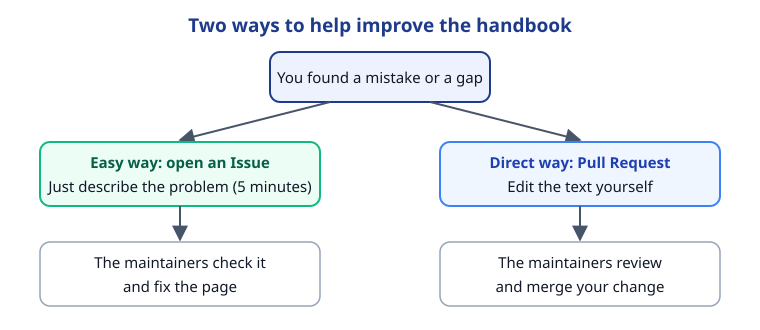
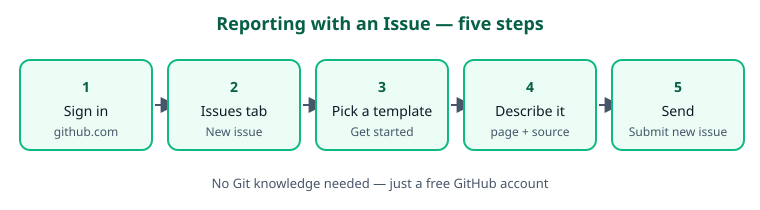
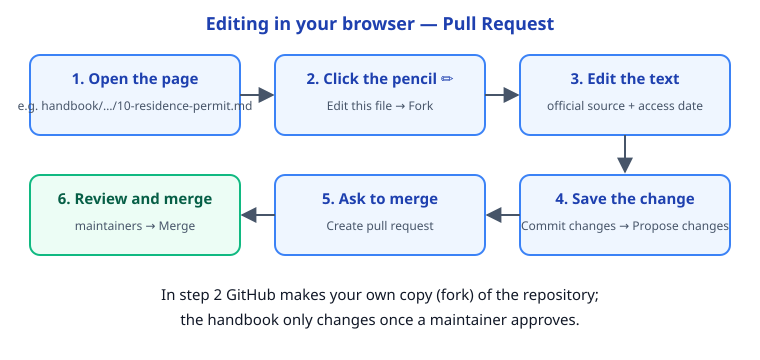

# 68. GitHub Guide — How to Contribute to This Handbook, Step by Step

<!-- disclaimer:start -->
> [!CAUTION]
> ### ⚠️ This handbook is guidance based on students' experience — not law and not official advice
>
> **Rules, amounts, deadlines and procedures can change at any time without notice.** The Iranian Student Association of Leibniz University Hannover (ISL) and the authors of this handbook accept **no responsibility** for the accuracy, completeness or currency of the content, or for the consequences of using it. Check with the responsible official office before you act; it always has the final word.
>
> ### 🗓️ This page was last updated: ⁦2026-10-26⁩
>
> Stay informed about changes: [changelog](../../CHANGELOG.md) · click **Watch** on GitHub · [ISL Telegram channel](https://t.me/hannover_iranian_students)
>
> Copyleft 🄯 ISL and contributors — free to use, share and change, as long as it stays under the same license ([GNU GPL v3 or later](../../LICENSE))
>
> 💬 About this page: [🐞 Report an error or broken link](https://github.com/FreeXYZ-HalfPI/Hannover-Handbook-InternationalStudents/issues/new?template=broken-link-or-error.md&title=%5Bhandbook/07-resources/68-github-guide.md%5D%20) · [💡 Suggest an idea](https://github.com/FreeXYZ-HalfPI/Hannover-Handbook-InternationalStudents/issues/new?template=idea.md&title=%5Bhandbook/07-resources/68-github-guide.md%5D%20) · [✍️ Share an experience](https://github.com/FreeXYZ-HalfPI/Hannover-Handbook-InternationalStudents/issues/new?template=experience.md&title=%5Bhandbook/07-resources/68-github-guide.md%5D%20) · [✏️ Edit it yourself](https://github.com/FreeXYZ-HalfPI/Hannover-Handbook-InternationalStudents/edit/main/handbook/07-resources/68-github-guide.md)
<!-- disclaimer:end -->

> [!TIP]
> **Last reviewed:** 2026-10-26 · **Section:** [Section 7 — Resources & Appendices](README.md) · **Key:** ⚠️ = needs confirmation · ℹ️ = note · 🌍 = depends on your nationality

## 1. Purpose

This handbook lives on GitHub so that anyone can fix a number, report a broken link or add an experience. This page shows the two ways to help — no programming knowledge needed.

## 2. Who needs this?

- Anyone who found a mistake, outdated information or a gap.
- Student groups who want to keep the handbook up to date.

## 3. Steps

### A) GitHub in one minute

GitHub is a website where the handbook's files are stored. Every change is saved with its author and date, and nothing reaches the handbook until a maintainer has checked it.



### B) Step zero: create a free account

1.  Go to [github.com/signup](https://github.com/signup) and create a free account with your e-mail address ([GitHub Docs – Creating an account](https://docs.github.com/en/get-started/start-your-journey/creating-an-account-on-github)).
2.  ℹ️ Your username is public on issues and changes; choose a neutral username if you don't want your real name shown.

### C) The easy way: report with an Issue (no Git needed)



1.  Sign in to GitHub and open the [Issues tab of the repository](https://github.com/FreeXYZ-HalfPI/Hannover-Handbook-InternationalStudents/issues).
2.  Click **New issue**.
3.  Choose one of the three templates ([choose a template](https://github.com/FreeXYZ-HalfPI/Hannover-Handbook-InternationalStudents/issues/new/choose)): broken link or error, student experience, or new topic.
4.  Fill in the form: which page, what is wrong, and the **correct official source** if you have one.
5.  Click **Submit new issue**. A maintainer replies and fixes the page ([GitHub Docs – Creating an issue](https://docs.github.com/en/issues/tracking-your-work-with-issues/using-issues/creating-an-issue)).

### D) The direct way: edit in your browser with a Pull Request



1.  Open the page you want to fix in the repository (e.g. `handbook/01-arriving-in-hannover/10-residence-permit.md`).
2.  Click the pencil icon **✏️ (Edit this file)** above the text. If you are not a team member, GitHub asks whether to **fork** the repository (make your own copy); confirm.
3.  Edit the text. **Main rule:** every new figure, deadline or fee needs an official source link right next to it. → [CONTRIBUTING.md](../../CONTRIBUTING.md)
4.  Click **Commit changes…**, write one short sentence about the change (e.g. "Update residence-permit fee for 2027") and click **Propose changes**.
5.  On the next page click **Create pull request** and tick the checklist in the template.
6.  A maintainer reads your change and may ask a question. Once approved it is **merged** and appears in the next PDF too ([GitHub Docs – Editing files](https://docs.github.com/en/repositories/working-with-files/managing-files/editing-files)).

### E) A new page

1.  Open [TEMPLATE.md](../../TEMPLATE.md) and keep its seven-part structure.
2.  Create a new file in the right section folder (**Add file → Create new file**), named like `69-topic-name.md`.
3.  Add the page to that section's `README.md` and to the [handbook contents](../README.md).
4.  Create a pull request as above.

### F) For people who use Git

```bash
git clone https://github.com/FreeXYZ-HalfPI/Hannover-Handbook-InternationalStudents.git
cd Hannover-Handbook-InternationalStudents
git switch -c fix-residence-fee
# edit the file
git add handbook/01-arriving-in-hannover/10-residence-permit.md
git commit -m "Update residence permit fee for 2027"
git push origin fix-residence-fee
```

Then click **Compare & pull request** on GitHub. Before sending, check the links (`bash tools/check_links.sh`), regenerate the sources tables (`python3 tools/build_sources.py`) and the search index (`python3 tools/build_search.py`), and build the PDF if you can (`python3 tools/build_pdf.py`). → [README](../../README.md)

### G) Golden rules

1.  **An official source for every claim**, with an access date.
2.  **Personal experiences only in section 7** of a page, always with a date.
3.  **No personal data:** no names of others, phone numbers, e-mail addresses, exact addresses, passport numbers or photos of documents — neither on pages nor in issues.
4.  **Write simply:** as if explaining to a friend who just arrived; short sentences, German terms in brackets.

## 4. Documents and costs

| Item | Required / possible | Notes | Source |
|----|----|----|----|
| GitHub account | Required for issues and changes | Free | [GitHub – Sign up](https://github.com/signup) |

## 5. Responsible office

- **Maintainers of this handbook:** via [GitHub Issues](https://github.com/FreeXYZ-HalfPI/Hannover-Handbook-InternationalStudents/issues)
- **Rules for contributors:** [CONTRIBUTING.md](../../CONTRIBUTING.md)

## 6. Sources and official links

Every link on this page was checked on the access date; the result is in the last column. If a link no longer works, report it on [page 57](../07-resources/57-contribute-experiences.md).

| # | Source | Publisher | Accessed | Result |
|----|----|----|----|----|
| 1 | [github.com/signup](https://github.com/signup) | github.com | 2026-10-26 | ⚠️ Blocks automated checks — open in a browser |
| 2 | [GitHub Docs – Creating an account](https://docs.github.com/en/get-started/start-your-journey/creating-an-account-on-github) | docs.github.com | 2026-10-26 | ✅ Opened |
| 3 | [Issues tab of the repository](https://github.com/FreeXYZ-HalfPI/Hannover-Handbook-InternationalStudents/issues) | github.com | 2026-10-26 | ✅ Opened |
| 4 | [choose a template](https://github.com/FreeXYZ-HalfPI/Hannover-Handbook-InternationalStudents/issues/new/choose) | github.com | 2026-10-26 | ✅ Opened |
| 5 | [GitHub Docs – Creating an issue](https://docs.github.com/en/issues/tracking-your-work-with-issues/using-issues/creating-an-issue) | docs.github.com | 2026-10-26 | ✅ Opened |
| 6 | [GitHub Docs – Editing files](https://docs.github.com/en/repositories/working-with-files/managing-files/editing-files) | docs.github.com | 2026-10-26 | ✅ Opened |

## 7. Student experiences (unofficial)

> [!NOTE]
> This section is for personal experiences; it is not a general rule or legal advice. Share yours (with a date) on [page 57](57-contribute-experiences.md) or by opening a GitHub issue.

- No experiences added yet.
